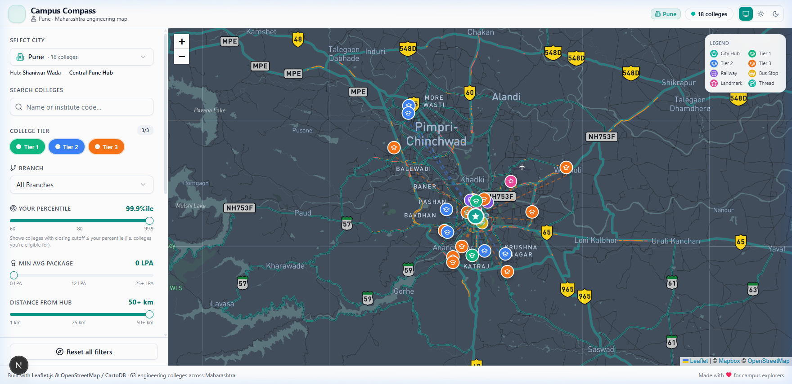
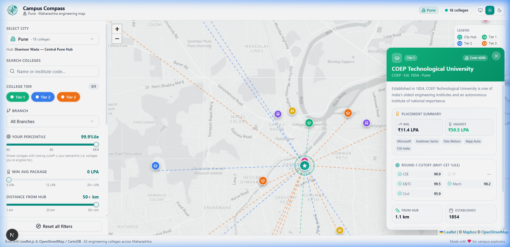
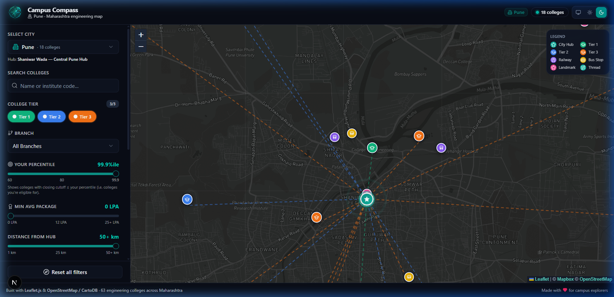

<div align="center">

  

  # 🧭 Campus Compass
  ### *Interactive Maharashtra Engineering College Discovery & Cutoff Analytics*

  [](https://collegecompass.ayuslabs.com)
  [](https://nextjs.org/)
  [](https://react.dev/)
  [](https://www.typescriptlang.org/)
  [](https://tailwindcss.com/)
  [](https://leafletjs.com/)

  <p align="center">
    A high-performance geo-visualization dashboard that helps MHT-CET aspirants search, filter, and compare <b>61+ top engineering colleges</b> across Maharashtra's major education hubs (<b>Pune, Mumbai, Nagpur, and Amravati</b>) — built using <b>only officially verified CAP data</b>.
  </p>

  **🌐 Live Production App:** [https://collegecompass.ayuslabs.com](https://collegecompass.ayuslabs.com)

</div>

---

## 📸 Screenshots & UI Preview

### 🗺️ Dashboard Overview (Live Map & Multi-Criteria Filtering)


### 💳 Detailed College Profile Drawer (CAP Cutoffs, Intake & Transit Data)


### 🌙 Sleek Dark Mode (CartoDB Dark Matter with Neon Hub Glows)


---

## 🎯 The Problem & Our Solution

During the MHT-CET CAP counseling rounds, students and parents face a tedious challenge: cross-referencing massive 100+ page PDF cutoff lists with real-world campus locations, travel times, and admission quotas.

**Campus Compass** unifies **spatial intelligence** with **academic admission data**:
- 📍 **Geographic Context**: View exact campus coordinates on interactive maps with real-time radial distance rings from central city landmarks.
- 🎯 **Percentile Eligibility Engine**: Enter your MHT-CET percentile and preferred branch to see where you qualify, against the official CAP **Round I / II / III** closing percentiles for A.Y. 2026-27 — switchable per round.
- 🏛️ **Seat-Type Aware**: Toggle between **Home University**, **Other than Home University** and **State Level** seat pools, exactly as DTE publishes them.
- 📋 **Official Institute Record**: DTE institute code, address, status (Government / Un-Aided), autonomy, minority status, affiliating university and course-wise sanctioned intake — straight off the CAP portal.
- 🚆 **Transit & Commute Insights**: Real-time calculated distances to nearest railway stations, bus stands, and key city hubs.

---

## 🌟 Key Features

* 🗺️ **Interactive Leaflet Map Engine**:
  * **Light Mode**: Crisp OpenStreetMap tiles with custom-styled SVG tier markers.
  * **Dark & Blue Modes**: Sleek CartoDB Dark Matter tiles with neon hub glows and node pins.
  * **Interactive Radius Circles**: Dynamic influence-radius circle representing the active distance filter.
* 📍 **Multi-City Hub Visualization**:
  * **Pune**: Shaniwar Wada
  * **Mumbai**: Dadar
  * **Nagpur**: Sitabuldi
  * **Amravati**: Rajkamal Square
  * *Displays dashed connecting threads from the hub to colleges with real-time hover distance calculations.*
* 🔍 **Cross-City Global Search**: Search instantly by college name or official DTE (Directorate of Technical Education) institute codes. Selecting a result automatically switches the city view and highlights the campus.
* ⚡ **Advanced Multi-Criteria Filtering**:
  * **Branch Cutoffs & Percentile Eligibility**: Filter across major branches to show colleges where the closing cutoff $\le$ your percentile.
  * **CAP Round & Seat Type**: Every cutoff in the app re-reads from the round and seat pool you pick.
  * **Institute Type**: Government / University, Autonomous (Un-Aided), Affiliated (Un-Aided), or outside the CAP — derived from the official Status and Autonomy fields, not a ranking.
  * **Distance**: Filter colleges within a 1km to 50km+ radius from the city's central hub.
  * **Layer Toggles**: Show/hide connecting threads, transit points (railways, bus stands), and local landmarks.
* 💳 **Comprehensive College Cards**: DTE institute code, official address, course-wise closing percentile and sanctioned intake, transit distances, and a direct link to the institute's DTE record and the round's cut-off PDF.
* 🌗 **Adaptive Theming**: Powered by `next-themes` with custom CSS micro-animations and custom color palettes (Light / Dark / Blue).

---

## 🛠️ Architecture & Tech Stack

* **Live Deployment**: Hosted on [Vercel](https://vercel.com/) at [collegecompass.ayuslabs.com](https://collegecompass.ayuslabs.com)
* **Frontend Framework**: [Next.js 16](https://nextjs.org/) (App Router) + [React 19](https://react.dev/)
* **Database & ORM**: [Prisma](https://www.prisma.io/) with [Supabase PostgreSQL](https://supabase.com/)
* **Language**: [TypeScript](https://www.typescriptlang.org/) (Strict typing across data models & spatial calculations)
* **Styling**: [Tailwind CSS v4](https://tailwindcss.com/) & [Tailwind Animate](https://github.com/jamiebuilds/tailwindcss-animate)
* **Mapping**: [Leaflet 1.9](https://leafletjs.com/) (Client-side dynamic rendering to prevent SSR hydration mismatches)
* **Animations**: [Framer Motion](https://www.framer.com/motion/)
* **Components**: [shadcn/ui](https://ui.shadcn.com/) & [Radix UI](https://www.radix-ui.com/) primitives

---

## 🚀 Getting Started

### Prerequisites

Ensure you have [Bun](https://bun.sh/) (recommended) or [Node.js 18+](https://nodejs.org/) installed.

### Installation & Local Setup

1. **Clone the repository**:
   ```bash
   git clone https://github.com/Anish974/college-compass.git
   cd college-compass
   ```

2. **Install dependencies**:
   ```bash
   npm install
   # or
   bun install
   ```

3. **Configure Environment Variables**:
   ```bash
   cp .env.example .env
   ```

4. **Run the development server**:
   ```bash
   npm run dev
   # or
   bun dev
   ```

5. **Open in browser**:
   Navigate to [http://localhost:3000](http://localhost:3000) (or view the live deployment at [collegecompass.ayuslabs.com](https://collegecompass.ayuslabs.com)).

---

## 📂 Project Structure

```
college-compass/
├── prisma/
│   ├── schema.prisma         # PostgreSQL relational models
│   └── seed.ts               # Automated dataset seeding script
├── public/
│   ├── logo.png              # Brand icon & favicon
│   └── screenshots/          # High-resolution UI previews for documentation
├── src/
│   ├── app/                  # Next.js App Router (layout, page, theme providers)
│   ├── components/           # Reusable UI components
│   │   ├── college-card.tsx  # Campus detailed profile drawer
│   │   ├── map-view.tsx      # Leaflet dynamic map layer & controls
│   │   ├── sidebar.tsx       # Multi-criteria filtering controls & search
│   │   └── theme-controller.tsx # Theme switcher (Light / Dark / Blue)
│   └── lib/
│       ├── college-data.ts   # Typed accessors over the generated dataset
│       ├── colleges.generated.json  # Built by /scripts — do not hand-edit
│       └── marker-icons.ts   # Custom SVG map pin generators
├── tailwind.config.ts        # Tailwind CSS v4 styling tokens
└── package.json              # Project metadata and dependencies
```

---

## 📊 Data Source & Methodology

**No figure in this app is estimated, interpolated or hand-typed.** `src/lib/colleges.generated.json` is built by the scripts in [`scripts/`](scripts/) from these official sources only:

| What | Source |
|---|---|
| Institute name, DTE code, address, status, autonomy, minority status, affiliating university, course-wise sanctioned intake | [State CET Cell CAP portal institute records](https://fe2026.mahacet.org/StaticPages/frmInstituteList.aspx?did=1884) |
| MHT-CET CAP **Round I** closing percentiles (2026-27) | [Official cut-off PDF](https://cappublicdocs2026.blob.core.windows.net/documents/2026ENGG_CAP1_MH_CutOff_V1.pdf) |
| MHT-CET CAP **Round II** closing percentiles (2026-27) | [Official cut-off PDF](https://cappublicdocs2026.blob.core.windows.net/documents/2026ENGG_CAP2_MH_CutOff.pdf) |
| MHT-CET CAP **Round III** closing percentiles (2026-27) | [Official cut-off PDF](https://cappublicdocs2026.blob.core.windows.net/documents/2026ENGG_CAP3_MH_CutOff.pdf) |
| Campus, hub, station and landmark coordinates | [OpenStreetMap](https://www.openstreetmap.org/copyright) (© OpenStreetMap contributors, ODbL) via Nominatim and Overpass |

Snapshot retrieved for academic year **2026-27**.

---

## 📄 License

This project is open-source under the [MIT License](LICENSE).
